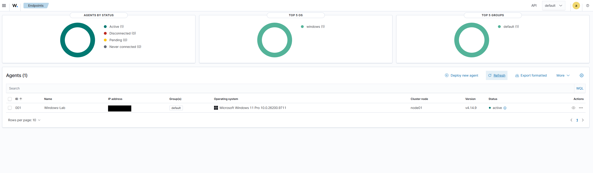
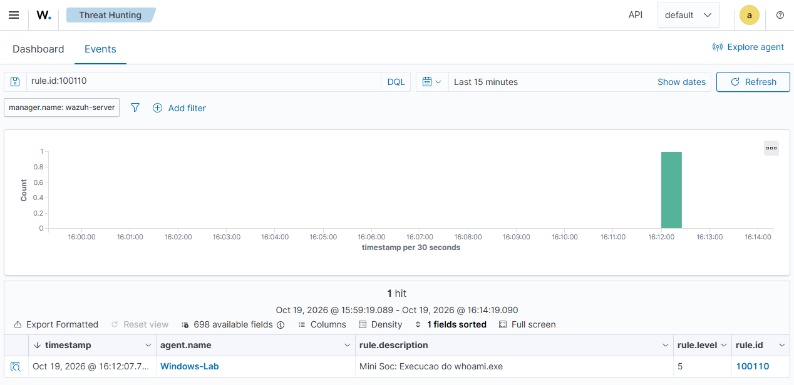
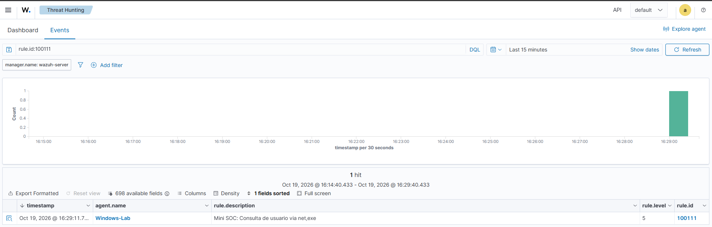
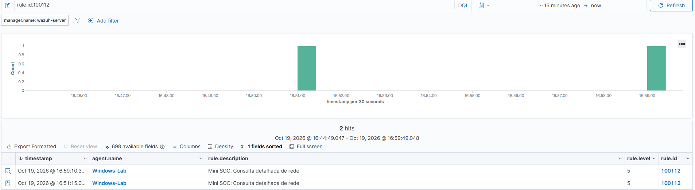

# Mini SOC com Wazuh e Sysmon

Este projeto foi desenvolvido para colocar em prática alguns conceitos de cibersegurança, principalmente monitoramento de eventos e criação de regras de detecção.

Montei um laboratório utilizando uma máquina virtual Linux com Wazuh e meu computador com Windows 11. A ideia era conseguir registrar atividades realizadas no Windows, enviar essas informações para o Wazuh e gerar alertas a partir de regras que eu mesmo configurasse.

Durante o projeto, criei três regras para identificar a execução de comandos específicos e fiz testes para verificar o funcionamento das detecções.

## Ambiente utilizado

- **Wazuh 4.14.9:** recebimento, análise e visualização dos eventos.
- **Sysmon 15.22:** coleta de informações sobre processos executados no Windows.
- **Wazuh Agent:** envio dos eventos do Windows para o servidor.
- **Windows 11 Pro:** sistema monitorado.
- **Linux:** sistema utilizado na máquina virtual do Wazuh.
- **VirtualBox:** criação e execução da máquina virtual.
- **PowerShell:** execução dos comandos utilizados nos testes.

## Configuração do laboratório

Primeiro, configurei uma máquina virtual no VirtualBox para executar o servidor Wazuh.

Utilizei uma rede Host-only para permitir a comunicação entre a máquina virtual e o Windows, sem precisar expor o servidor diretamente à rede externa.

Depois, instalei o Wazuh Agent no Windows e configurei a conexão com o servidor.

Com a comunicação funcionando, instalei o Sysmon para registrar informações mais detalhadas sobre os processos executados.

Também alterei o arquivo `ossec.conf` do agente para que os eventos do Sysmon fossem enviados ao Wazuh.

O fluxo ficou assim:

**Windows -> Sysmon -> Wazuh Agent -> Wazuh Server -> Regras de detecção -> Alertas**

### Agente conectado

O agente Windows-Lab foi registrado no Wazuh e ficou com o status Active.

## Regras de detecção

Criei três regras personalizadas no arquivo `local_rules.xml`, utilizando os eventos de criação de processos do Sysmon (Event ID 1).

O arquivo com as regras está disponível em [Regras/local_rules.xml](Regras/local_rules.xml).

### 1. Detecção do whoami.exe

**Regra:** 100110

A primeira regra foi criada para detectar a execução do `whoami.exe`, comando utilizado para identificar o usuário que está executando um processo no Windows.

Executei o comando pelo PowerShell e verifiquei se o Wazuh gerava um alerta.

**Comando testado:** `whoami.exe`

O alerta foi gerado corretamente e consegui visualizar informações como o processo executado, o horário e o processo que iniciou a execução.

### 2. Detecção do net.exe user

**Regra:** 100111

Na segunda regra, o objetivo foi identificar a execução de `net.exe user`, utilizado para consultar as contas de usuários locais do Windows.

Configurei a regra para verificar o executável e a linha de comando.

**Comando testado:** `net.exe user`

Após executar o comando, o Wazuh gerou o alerta esperado.

### 3. Detecção do ipconfig.exe /all

**Regra:** 100112

A terceira regra foi criada para identificar a execução do `ipconfig.exe` com o parâmetro `/all`, que permite consultar informações detalhadas das configurações de rede.

**Comando testado:** `ipconfig.exe /all`

Essa regra precisou de alguns ajustes durante o desenvolvimento. Inicialmente, não consegui gerar o alerta com as condições configuradas. Para investigar o problema, simplifiquei a regra, testei a identificação do processo e depois adicionei novamente a condição referente ao parâmetro `/all`.

Ao final, consegui gerar um alerta com a configuração atualizada.

## Resultados

Consegui configurar a comunicação entre o Windows e o Wazuh, coletar os eventos do Sysmon e gerar alertas utilizando as três regras personalizadas.

Os testes também permitiram consultar informações como:

- Processo executado e linha de comando.
- Usuário responsável pela execução.
- Processo de origem.
- Data e horário do evento.
- Regra responsável pelo alerta.

Durante a configuração, encontrei alguns problemas relacionados à sintaxe do XML e às condições das regras. Fiz correções e novos testes até conseguir visualizar os alertas no dashboard.

## Limitações

Os comandos utilizados são legítimos do Windows. A execução deles, isoladamente, não significa que ocorreu um ataque.

As regras deste projeto identificam comportamentos específicos, mas ainda não fazem correlação entre diferentes eventos nem conseguem determinar automaticamente se uma atividade é maliciosa.

Também não realizei uma avaliação completa de falsos positivos ou de diferentes formas de executar os mesmos comandos. Na terceira regra, confirmei a geração do alerta com `/all`, mas não documentei de forma conclusiva um teste negativo da configuração final.

O laboratório foi utilizado apenas para estudos, sem execução de malware real.

## Arquivos do projeto

- **Regras:** arquivo XML com as três detecções.
- **Evidencias:** capturas dos alertas e dos eventos analisados.
- **Relatorios:** documentação individual das investigações realizadas.

## O que aprendi

Esse projeto me ajudou a entender melhor como os registros de um computador podem ser utilizados para monitoramento de segurança.

Também pude praticar a configuração de ferramentas em Windows e Linux, trabalhar com arquivos XML, interpretar logs e investigar por que determinadas regras não estavam funcionando.

Foi meu primeiro laboratório de monitoramento com Wazuh, desenvolvido para estudar conceitos de SOC e Blue Team.
